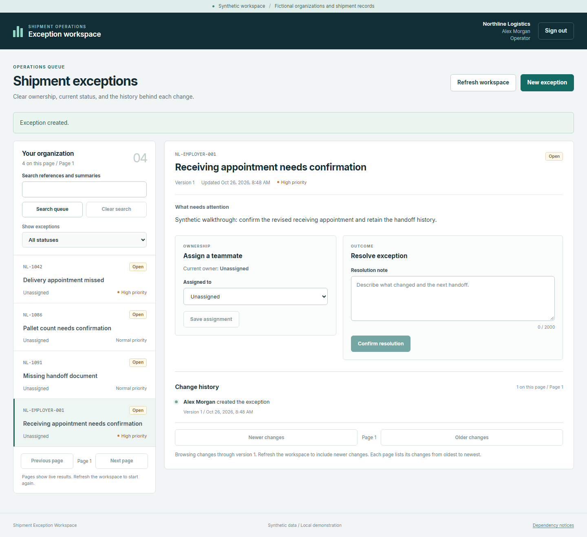
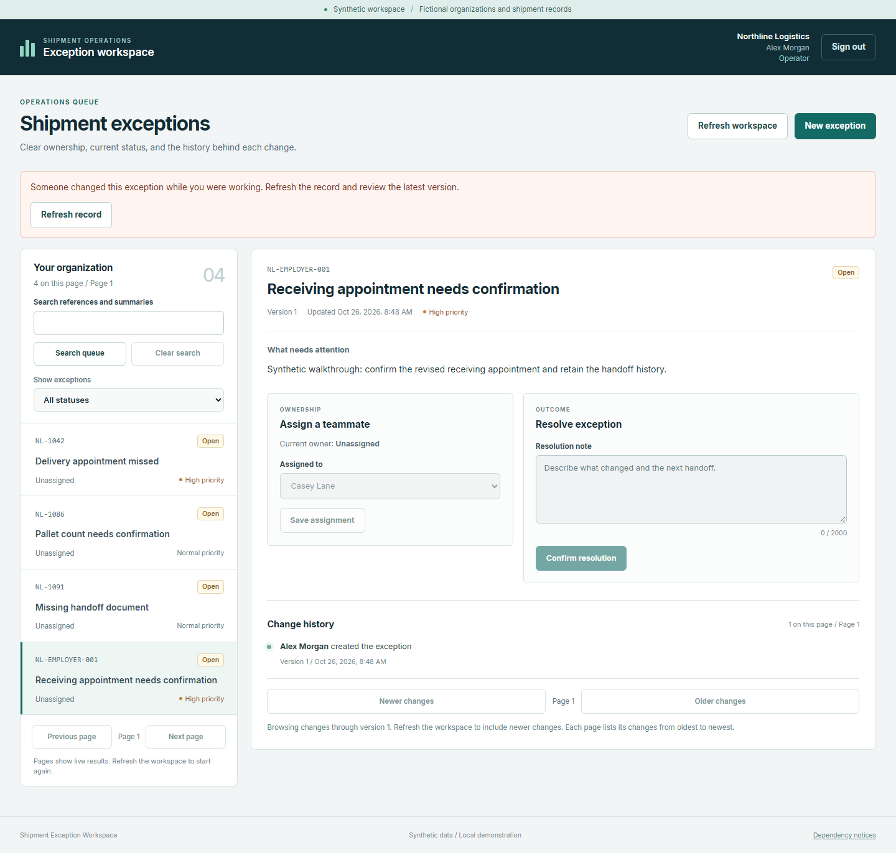
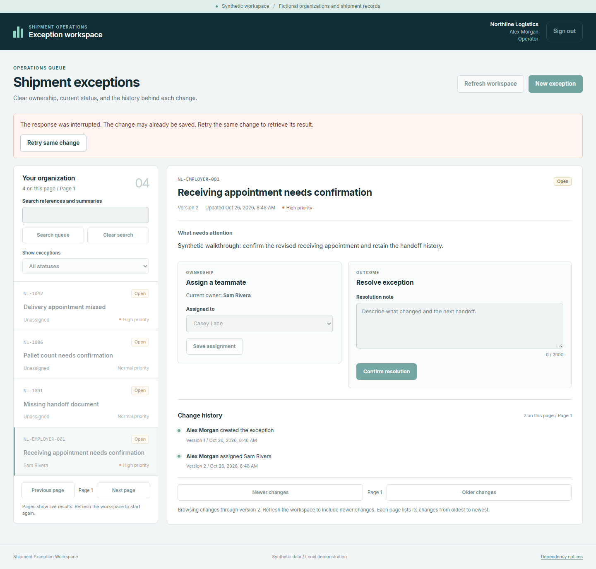
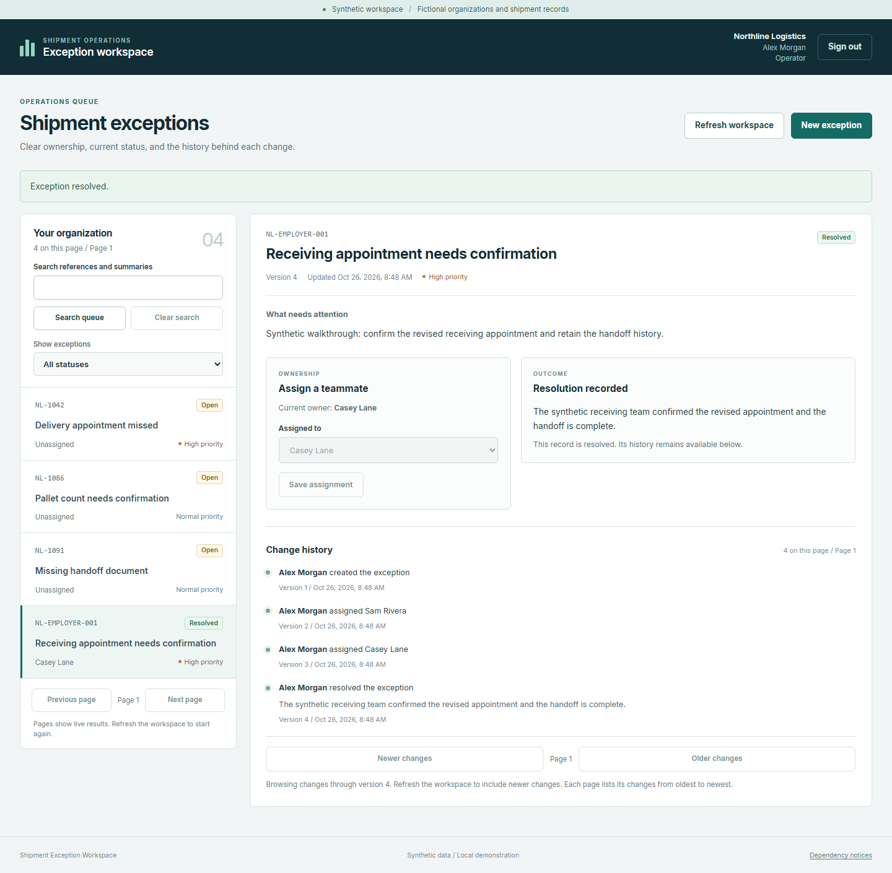

# Create, recover and resolve one synthetic exception

This walkthrough follows an actual installed v0.9.0 operator journey on October 26, 2026. Alex creates a synthetic shipment exception, handles a stale edit and an interrupted response, then records its resolution. React, the Python API and PostgreSQL supplied the displayed state. The screenshots are captures of the application, with no substituted interface or invented history.

Public demo mode is a reviewer experience. Visitors can browse records and history, but cannot perform the operator actions below. Its provisioned demonstration history is separate from this executed local workflow. These captures do not establish that a public deployment is running.

## 1. Create the record

Alex enters reference `NL-EMPLOYER-001`, a summary, details and high priority through **New exception**. The saved record starts open and unassigned at version 1. Its first history event records creation.

## 2. Refuse a stale edit and refresh

A separate actual API request assigns the record to Sam, saving version 2 while the page still displays version 1. Alex then selects Casey and chooses **Save assignment**. The server returns HTTP 409 `version_conflict`, and the page requires **Refresh record**. That refused attempt adds no history event. Refreshing reveals Sam's saved assignment and version 2 before another edit.

## 3. Recover an interrupted response

Alex selects Casey again. For this controlled case, the headless check forwards the request to the actual server, receives its committed version-3 response, then deliberately drops delivery to the page. This simulates a lost response after a successful write. The page still shows version 2 and warns that the change may already be saved.

Choosing **Retry same change** sends the original key and body. The actual server returns its saved response with `idempotency-replayed: true`. The two attempts produce one Casey assignment event. Server readback remains at version 3 with three events, matching the state before the retry. A stale edit needs a current-state refresh. An uncertain committed intent needs its original identity, while the current session remains authorized.

## 4. Resolve and inspect the complete history

Alex enters the resolution through the ordinary form. The server saves version 4. The four actual events are:

| Version | Saved change |
| --- | --- |
| 1 | Alex created the exception. |
| 2 | The independent API request assigned Sam. |
| 3 | Alex's interrupted request assigned Casey. Its retry added no event. |
| 4 | Alex recorded the resolution. |

The desktop page and API readback agree on the resolved state and four events. Reloading preserves them.

## 5. Read the result on a narrow screen

A fresh headless context signs in, opens the same finished record at 390 pixels wide with a dark appearance preference, then reloads it. Version 4, the resolution and all four events remain available. The checked page fits the viewport without horizontal scrolling.

## Capture identity and limits

These captures came from the ordinary installed v0.9.0 candidate at source [`ff0935c23e3aedd9cf6018bb4c73c5dd2228d2a8`](https://github.com/T92T1914/shipment-exception-workspace/tree/ff0935c23e3aedd9cf6018bb4c73c5dd2228d2a8). Its wheel SHA256 was `23c6f969600794ec8e89cbf3258d5219b4e19dfe1ae81ecd7036615837c2bcb5`. The environment and disposable synthetic database were outside the checkout. Capture used an isolated headless browser, with no foreground desktop capture or audio.

This is execution at that candidate, not a fresh run at a later final head. Applying the captures to a later release requires a documented source or payload comparison. The [verification notes](VERIFICATION.md) carry the current delivery identity and separate local, installed, CI and hosted results.

The interruption was deliberately introduced after a real server commit. It is not an observed public-host outage. Viewport and appearance emulation do not qualify physical devices, every accessibility setting, production operation or recovery from a failed database. All people, organizations and shipment records shown here are synthetic.
